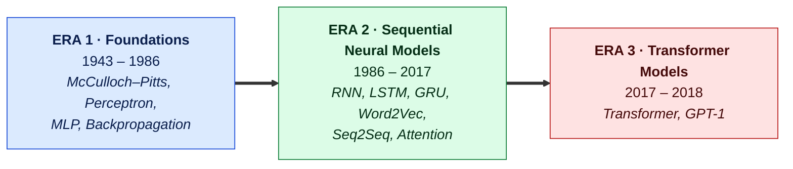
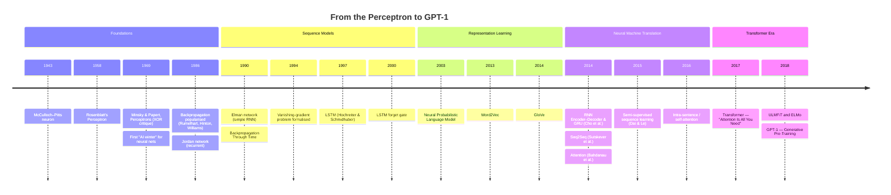

# Neural Network Lineage: From the Perceptron to GPT-1

> **A historical genealogy of the neural network architectures that led to the first Generative Pre-trained Transformer (1943 – 2018).**

This repository traces the chain of ideas connecting Frank Rosenblatt's 1958 Perceptron to OpenAI's 2018 GPT-1. Each model entry records **when it was introduced, what it is, what it innovated, which problem it solved, and what it led to**, with links to the original papers.

Neural network history is not a clean tree. Many models inherit ideas from more than one parent (the Transformer, for example, draws on attention, encoder–decoder translation, and learned embeddings all at once). The master figure below is therefore drawn as a **directed acyclic graph (DAG)**, not a strict family tree.

---

## Table of Contents

1. [The Three Eras at a Glance](#1-the-three-eras-at-a-glance)
2. [Master Genealogy Figure](#2-master-genealogy-figure)
3. [Chronological Timeline](#3-chronological-timeline)
4. [Summary Table](#4-summary-table)
5. [Model-by-Model Lineage](#5-model-by-model-lineage)
   - [5.0 McCulloch–Pitts Neuron (1943) — precursor](#50-mccullochpitts-neuron-1943--precursor)
   - [5.1 Perceptron (1958)](#51-perceptron-1958)
   - [5.2 Multi-Layer Perceptron + Backpropagation (1986)](#52-multi-layer-perceptron--backpropagation-1986)
   - [5.3 Recurrent Neural Network (1986 / 1990)](#53-recurrent-neural-network-1986--1990)
   - [5.4 Long Short-Term Memory (1997)](#54-long-short-term-memory-lstm-1997)
   - [5.5 Neural Language Model & Word2Vec (2003 / 2013)](#55-neural-language-model-2003--word2vec-2013)
   - [5.6 GloVe (2014)](#56-glove-2014)
   - [5.7 Sequence-to-Sequence Encoder–Decoder (2014)](#57-sequence-to-sequence-encoderdecoder-2014)
   - [5.8 Gated Recurrent Unit (2014)](#58-gated-recurrent-unit-gru-2014)
   - [5.9 Attention Mechanism (2014)](#59-attention-mechanism-2014)
   - [5.10 Self-Attention (2016 – 2017)](#510-self-attention-2016--2017)
   - [5.11 Language-Model Pre-training Precursors (2015 – 2018)](#511-language-model-pre-training-precursors-2015--2018)
   - [5.12 Transformer (2017)](#512-transformer-2017)
   - [5.13 GPT-1 (2018)](#513-gpt-1-2018)
6. [Key Papers by Model Type](#6-key-papers-by-model-type)
7. [Further Reading](#8-further-reading)

---

## 1. The Three Eras at a Glance

Before the detailed genealogy, a high-level frame helps: the path to GPT-1 passes through three broad eras.

| Era | Core question | Defining answer |
|-----|---------------|-----------------|
| **Foundations** | Can a machine *learn* weights from data? | The Perceptron learning rule; backpropagation through hidden layers |
| **Sequential models** | How do we process inputs of arbitrary length, like sentences? | Recurrence with gated memory, learned word vectors, attention over encoder states |
| **Transformer models** | Can we drop recurrence entirely and scale? | Self-attention in parallel, then generative pre-training on unlabeled text |

---

## 2. Master Genealogy Figure

**Figure 1. Historical Genealogy of Neural Network Architectures Leading to GPT-1 (1943 – 2018)**

Solid arrows (`──►`) are **direct architectural descendants**. Dashed arrows (`- - ►`) are **conceptual influence**. Thick arrows (`══►`) mark **major paradigm shifts**.

```mermaid
flowchart LR
    subgraph F["Foundations · 1943–1986"]
        direction TB
        MP["McCulloch–Pitts<br/>Neuron<br/>1943"]
        P["Perceptron<br/>1958"]
        MPC["Minsky & Papert<br/><i>Perceptrons</i><br/>1969"]
        MLP["MLP +<br/>Backpropagation<br/>1986"]
        MP --> P
        P -.->|"critique: XOR"| MPC
        MPC -.->|"motivates hidden layers"| MLP
        P ==> MLP
    end

    subgraph S["Sequence Models · 1986–2014"]
        direction TB
        RNN["Recurrent Neural<br/>Network<br/>1986 / 1990"]
        LSTM["LSTM<br/>1997"]
        GRU["GRU<br/>2014"]
        RNN --> LSTM
        LSTM --> GRU
    end

    subgraph R["Representation Learning · 2003–2014"]
        direction TB
        NPLM["Neural Prob.<br/>Language Model<br/>2003"]
        W2V["Word2Vec<br/>2013"]
        GLOVE["GloVe<br/>2014"]
        NPLM --> W2V
        W2V -.-> GLOVE
    end

    subgraph N["Neural Machine Translation · 2014–2017"]
        direction TB
        S2S["Seq2Seq<br/>Encoder–Decoder<br/>2014"]
        ATT["Attention<br/>(Bahdanau)<br/>2014"]
        SA["Self-Attention<br/>2016–2017"]
        S2S --> ATT
        ATT --> SA
    end

    subgraph T["Transformer Era · 2017–2018"]
        direction TB
        PRE["LM Pre-training<br/>Dai & Le · ULMFiT · ELMo<br/>2015–2018"]
        TR["<b>TRANSFORMER</b><br/><i>Attention Is All You Need</i><br/>2017"]
        GPT["<b>GPT-1</b><br/>2018"]
        TR ==>|"decoder-only stack"| GPT
        PRE -.->|"pre-train, then fine-tune"| GPT
    end

    MLP ==> RNN
    LSTM --> S2S
    GRU --> S2S
    LSTM -.-> PRE
    W2V -.->|"learned embeddings"| S2S
    GLOVE -.-> PRE
    SA ==> TR
    S2S -->|"encoder–decoder template"| TR
    MLP -.->|"position-wise FFN"| TR

    classDef found fill:#DBEAFE,stroke:#1D4ED8,color:#0B1F4D
    classDef seq fill:#DCFCE7,stroke:#15803D,color:#052E16
    classDef emb fill:#F3F4F6,stroke:#4B5563,color:#111827
    classDef att fill:#FFEDD5,stroke:#C2410C,color:#431407
    classDef trans fill:#FEE2E2,stroke:#B91C1C,color:#450A0A,stroke-width:3px
    classDef dec fill:#CCFBF1,stroke:#0F766E,color:#042F2E,stroke-width:3px
    classDef event fill:#FFFFFF,stroke:#6B7280,color:#374151,stroke-dasharray:4 3

    class MP,P,MLP found
    class MPC event
    class RNN,LSTM,GRU seq
    class NPLM,W2V,GLOVE emb
    class S2S,ATT,SA att
    class PRE emb
    class TR trans
    class GPT dec
```

**Reading the figure.** Four tributaries feed the Transformer: (1) the MLP, which survives inside every Transformer layer as the position-wise feed-forward network; (2) the recurrent sequence models, which established the encoder–decoder template; (3) learned word embeddings; and (4) the attention line, which ends in self-attention. GPT-1 then takes the Transformer's **decoder half** and combines it with the **pre-train-then-fine-tune** recipe developed in the LSTM era.

---

## 3. Chronological Timeline

**Figure 2. Chronological Timeline of Neural Network Milestones Leading to GPT-1**

### Plain-text timeline (for print and quick scanning)

| Year | Milestone | Authors |
|------|-----------|---------|
| 1943 | McCulloch–Pitts neuron | Warren McCulloch, Walter Pitts |
| 1958 | **Perceptron** | Frank Rosenblatt |
| 1969 | *Perceptrons* critique (XOR limitation) | Marvin Minsky, Seymour Papert |
| 1986 | **Backpropagation** for MLPs | David Rumelhart, Geoffrey Hinton, Ronald Williams |
| 1986 | Jordan recurrent network | Michael Jordan |
| 1990 | **Elman RNN**; Backpropagation Through Time | Jeffrey Elman; Paul Werbos |
| 1994 | Vanishing gradients in RNNs analysed | Yoshua Bengio, Patrice Simard, Paolo Frasconi |
| 1997 | **LSTM** | Sepp Hochreiter, Jürgen Schmidhuber |
| 2003 | Neural Probabilistic Language Model | Yoshua Bengio et al. |
| 2013 | **Word2Vec** | Tomáš Mikolov et al. |
| 2014 | **GloVe** | Jeffrey Pennington, Richard Socher, Christopher Manning |
| 2014 | **RNN Encoder–Decoder & GRU** | Kyunghyun Cho et al. |
| 2014 | **Seq2Seq** | Ilya Sutskever, Oriol Vinyals, Quoc Le |
| 2014 | **Attention** | Dzmitry Bahdanau, Kyunghyun Cho, Yoshua Bengio |
| 2015 | Semi-supervised sequence learning | Andrew Dai, Quoc Le |
| 2016 | Self-attention (LSTMN; decomposable attention) | Cheng et al.; Parikh et al. |
| 2017 | **Transformer** | Ashish Vaswani et al. |
| 2018 | ULMFiT; ELMo | Howard & Ruder; Peters et al. |
| 2018 | **GPT-1** | Alec Radford, Karthik Narasimhan, Tim Salimans, Ilya Sutskever |

---

## 4. Summary Table

| Year | Model | Key innovation | Problem solved | Direct descendants |
|------|-------|----------------|----------------|--------------------|
| 1943 | McCulloch–Pitts Neuron | Neuron as a binary threshold logic unit | Showed networks of simple units can compute logic | Perceptron |
| 1958 | Perceptron | Weights **learned** from labelled examples | Hand-wiring every weight | MLP |
| 1986 | MLP + Backprop | Gradient flows backward through hidden layers | Non-linearly separable problems (XOR) | RNN, CNN, every deep net |
| 1986/90 | RNN | Hidden state fed back as input | Variable-length, ordered input | LSTM, GRU |
| 1997 | LSTM | Gated memory cell (constant error flow) | Vanishing gradients over long sequences | GRU, Seq2Seq, ELMo |
| 2003/13 | NPLM / Word2Vec | Dense, learned word vectors | Sparse one-hot words with no notion of similarity | GloVe, embedding layers |
| 2014 | GloVe | Embeddings from global co-occurrence counts | Word2Vec ignored corpus-wide statistics | Pre-trained input layers |
| 2014 | Seq2Seq | Encoder → fixed vector → decoder | Mapping a sequence to a sequence of different length | Attention, Transformer |
| 2014 | GRU | Two-gate simplification of LSTM | LSTM's cost and complexity | Seq2Seq variants |
| 2014 | Attention | Decoder looks back at **all** encoder states | Fixed-length bottleneck vector | Self-attention, Transformer |
| 2016–17 | Self-Attention | A sequence attends to itself | Long-range dependencies inside one sentence | Transformer |
| 2015–18 | LM Pre-training | Pre-train on raw text, fine-tune on task | Scarce labelled data | GPT-1, BERT |
| 2017 | Transformer | Recurrence removed; multi-head self-attention | Slow, sequential RNN training | GPT-1, BERT, T5 |
| 2018 | GPT-1 | Decoder-only Transformer, generative pre-training | Task-specific architectures for every NLP task | GPT-2, (influenced) BERT |

---

## 5. Model-by-Model Lineage

### 5.0 McCulloch–Pitts Neuron (1943) — precursor

| Field | Detail |
|-------|--------|
| **Year introduced** | 1943 |
| **Model name** | McCulloch–Pitts (MCP) Neuron |
| **Short description** | A mathematical model of a biological neuron: it sums binary inputs and fires (outputs 1) if the sum reaches a fixed threshold. |
| **Innovation** | First formal description of a neuron as a logic device; showed that networks of such units can implement any Boolean function. |
| **Problem solved** | Gave a precise, computable bridge between neuroscience and logic. |
| **Limitation** | Weights and thresholds were set by hand. There was **no learning**. |
| **Descendants** | Perceptron |
| **Key paper** | McCulloch & Pitts, [*A Logical Calculus of the Ideas Immanent in Nervous Activity*](https://doi.org/10.1007/BF02478259), *Bulletin of Mathematical Biophysics*, 1943 |

---

### 5.1 Perceptron (1958)

| Field | Detail |
|-------|--------|
| **Year introduced** | 1958 (hardware *Mark I Perceptron* built 1960) |
| **Model name** | Perceptron |
| **Short description** | A single layer of adjustable weights followed by a step function. It classifies an input into one of two classes by drawing a straight line (hyperplane) between them. |
| **Innovation** | The **Perceptron learning rule**: weights are adjusted automatically from labelled examples, `w ← w + η (y − ŷ) x`. The convergence theorem (Novikoff, 1962) guarantees it finds a solution if the classes are linearly separable. |
| **Problem solved** | Removed the need to hand-design every connection. The machine could learn from data. |
| **Limitation** | Minsky & Papert (1969) proved that a single-layer perceptron **cannot learn XOR** or other non-linearly separable functions. Their critique contributed to a long decline in neural-network funding. |
| **Descendants** | Multi-Layer Perceptron (MLP) |
| **Key paper** | Rosenblatt, [*The Perceptron: A Probabilistic Model for Information Storage and Organization in the Brain*](https://doi.org/10.1037/h0042519), *Psychological Review*, 1958 |

---

### 5.2 Multi-Layer Perceptron + Backpropagation (1986)

| Field | Detail |
|-------|--------|
| **Year introduced** | 1986 (popularised); reverse-mode differentiation by Linnainmaa 1970, applied to neural nets by Werbos 1974 |
| **Model name** | Multi-Layer Perceptron (MLP) trained with Backpropagation |
| **Short description** | Stacks of perceptron-like units with one or more **hidden layers** and smooth, differentiable activations (e.g. sigmoid), trained end-to-end by gradient descent. |
| **Innovation** | **Backpropagation**: the chain rule computes how much every weight, in every layer, contributed to the error, so hidden layers can learn their own internal features. |
| **Problem solved** | Overcame the Perceptron's linear limit; MLPs learn XOR and, per the universal approximation theorem (Cybenko, 1989), can approximate any continuous function. |
| **Limitation** | Fixed-size input. It has no memory of order, so it cannot naturally process sentences of varying length. |
| **Descendants** | RNN, CNN, and every modern deep network. Lives on inside the Transformer as the **position-wise feed-forward network**. |
| **Key paper** | Rumelhart, Hinton & Williams, [*Learning Representations by Back-Propagating Errors*](https://doi.org/10.1038/323533a0), *Nature*, 1986 |

---

### 5.3 Recurrent Neural Network (1986 / 1990)

| Field | Detail |
|-------|--------|
| **Year introduced** | 1986 (Jordan network); 1990 (Elman "simple recurrent network") |
| **Model name** | Recurrent Neural Network (RNN) |
| **Short description** | A network that reads a sequence one element at a time, carrying a **hidden state** `hₜ = f(W·xₜ + U·hₜ₋₁)` that summarises everything seen so far. |
| **Innovation** | Recurrent connections give the network memory. Weights are **shared across time steps**, and it is trained with **Backpropagation Through Time (BPTT)**. |
| **Problem solved** | Handling variable-length, ordered data such as text, speech, and time series. |
| **Limitation** | **Vanishing / exploding gradients** (Hochreiter 1991; Bengio et al. 1994): the error signal shrinks or blows up as it travels back through many steps, so the network forgets long-range context. |
| **Descendants** | LSTM, GRU, Seq2Seq |
| **Key papers** | Elman, [*Finding Structure in Time*](https://doi.org/10.1207/s15516709cog1402_1), *Cognitive Science*, 1990 · Jordan, [*Serial Order: A Parallel Distributed Processing Approach*](https://doi.org/10.1016/S0166-4115(97)80111-2), 1986 (reprinted 1997) · Werbos, [*Backpropagation Through Time*](https://doi.org/10.1109/5.58337), 1990 · Bengio et al., [*Learning Long-Term Dependencies with Gradient Descent is Difficult*](https://doi.org/10.1109/72.279181), 1994 |

---

### 5.4 Long Short-Term Memory (LSTM) (1997)

| Field | Detail |
|-------|--------|
| **Year introduced** | 1997 (forget gate added 2000) |
| **Model name** | Long Short-Term Memory (LSTM) |
| **Short description** | An RNN unit with a separate **cell state** that runs along the sequence like a conveyor belt, controlled by learned **gates**. |
| **Innovation** | The **Constant Error Carousel** plus input, output and (from 2000) forget gates. Gates decide what to write, keep, and read, so gradients can flow across hundreds of steps without vanishing. |
| **Problem solved** | The vanishing-gradient problem that crippled simple RNNs on long sequences. |
| **Limitation** | Still strictly sequential: step *t* must wait for step *t − 1*, which makes training slow and hard to parallelise on GPUs. |
| **Descendants** | GRU, Seq2Seq (LSTM encoder–decoders), ELMo, ULMFiT |
| **Key papers** | Hochreiter & Schmidhuber, [*Long Short-Term Memory*](https://doi.org/10.1162/neco.1997.9.8.1735), *Neural Computation*, 1997 · Gers, Schmidhuber & Cummins, [*Learning to Forget*](https://doi.org/10.1162/089976600300015015), 2000 |

---

### 5.5 Neural Language Model (2003) & Word2Vec (2013)

| Field | Detail |
|-------|--------|
| **Year introduced** | 2003 (Neural Probabilistic Language Model); 2013 (Word2Vec) |
| **Model name** | NPLM → Word2Vec (Skip-gram and CBOW) |
| **Short description** | Bengio's NPLM learned a dense vector for each word while predicting the next word. Word2Vec stripped this down to a shallow, very fast model trained on billions of words. |
| **Innovation** | **Distributed word representations**: words become points in a continuous space where similar words sit close together and offsets encode relations (*king − man + woman ≈ queen*). Word2Vec added **negative sampling** to make training cheap. |
| **Problem solved** | One-hot vectors are huge, sparse, and treat every word as equally different from every other. Embeddings capture meaning and generalise to unseen word combinations. |
| **Limitation** | One static vector per word. "Bank" has the same embedding in "river bank" and "bank loan." |
| **Descendants** | GloVe, the embedding layer of every later model (Seq2Seq, Transformer, GPT-1), contextual embeddings (ELMo) |
| **Key papers** | Bengio et al., [*A Neural Probabilistic Language Model*](https://www.jmlr.org/papers/v3/bengio03a.html), *JMLR*, 2003 · Mikolov et al., [*Efficient Estimation of Word Representations in Vector Space*](https://arxiv.org/abs/1301.3781), 2013 · Mikolov et al., [*Distributed Representations of Words and Phrases and their Compositionality*](https://arxiv.org/abs/1310.4546), 2013 |

---

### 5.6 GloVe (2014)

| Field | Detail |
|-------|--------|
| **Year introduced** | 2014 |
| **Model name** | GloVe (Global Vectors for Word Representation) |
| **Short description** | Word embeddings learned by factorising a corpus-wide **word–word co-occurrence matrix**, with a weighted least-squares objective on log co-occurrence counts. |
| **Innovation** | Combined the strengths of global matrix-factorisation methods (like LSA) with the local context-window approach of Word2Vec. |
| **Problem solved** | Word2Vec learns only from local windows and under-uses corpus-wide statistics. GloVe makes ratios of co-occurrence probabilities directly meaningful. |
| **Limitation** | Still static, context-free vectors. |
| **Descendants** | Widely used as pre-trained input layers for LSTM models in 2014–2018 (including inputs to ELMo-era systems) |
| **Key paper** | Pennington, Socher & Manning, [*GloVe: Global Vectors for Word Representation*](https://aclanthology.org/D14-1162/), EMNLP 2014 |

---

### 5.7 Sequence-to-Sequence Encoder–Decoder (2014)

| Field | Detail |
|-------|--------|
| **Year introduced** | 2014 |
| **Model name** | Sequence-to-Sequence (Seq2Seq) / RNN Encoder–Decoder |
| **Short description** | One RNN (the **encoder**) reads the source sentence into a fixed-length "thought vector"; a second RNN (the **decoder**) generates the target sentence word by word from that vector. |
| **Innovation** | A general, end-to-end neural recipe for mapping one sequence to another of a **different length**. Sutskever et al. also found that reversing the source sentence eased optimisation. |
| **Problem solved** | Machine translation, summarisation and similar tasks where input and output lengths differ, without hand-built phrase tables. |
| **Limitation** | The **fixed-length bottleneck**: the entire source sentence must be squeezed into one vector, so quality drops sharply on long sentences. |
| **Descendants** | Attention-based NMT, the Transformer's encoder–decoder layout |
| **Key papers** | Sutskever, Vinyals & Le, [*Sequence to Sequence Learning with Neural Networks*](https://arxiv.org/abs/1409.3215), 2014 · Cho et al., [*Learning Phrase Representations using RNN Encoder–Decoder for Statistical Machine Translation*](https://arxiv.org/abs/1406.1078), 2014 |

---

### 5.8 Gated Recurrent Unit (GRU) (2014)

| Field | Detail |
|-------|--------|
| **Year introduced** | 2014 |
| **Model name** | Gated Recurrent Unit (GRU) |
| **Short description** | A streamlined gated RNN that merges the LSTM's cell and hidden state and uses just two gates: **update** and **reset**. |
| **Innovation** | Fewer parameters and simpler computation than LSTM, with comparable accuracy on many tasks. |
| **Problem solved** | LSTM's computational cost and design complexity, while still mitigating vanishing gradients. |
| **Limitation** | Inherits the sequential-computation bottleneck of all RNNs. |
| **Descendants** | GRU-based encoders/decoders (e.g. in Bahdanau attention); a sibling of LSTM rather than a direct ancestor of the Transformer |
| **Key papers** | Cho et al., [*Learning Phrase Representations using RNN Encoder–Decoder*](https://arxiv.org/abs/1406.1078), 2014 · Chung et al., [*Empirical Evaluation of Gated Recurrent Neural Networks on Sequence Modeling*](https://arxiv.org/abs/1412.3555), 2014 |

---

### 5.9 Attention Mechanism (2014)

| Field | Detail |
|-------|--------|
| **Year introduced** | 2014 (arXiv; published ICLR 2015) |
| **Model name** | Additive (Bahdanau) Attention; later multiplicative (Luong) attention, 2015 |
| **Short description** | Instead of one fixed context vector, the decoder computes a **fresh, weighted average of all encoder hidden states** at every output step. The weights ("alignment scores") say where to look. |
| **Innovation** | **Soft, learned alignment** between output and input positions, trained jointly with the translation model. |
| **Problem solved** | The Seq2Seq fixed-length bottleneck. Translation quality no longer collapsed on long sentences, and the attention weights were interpretable. |
| **Limitation** | Still bolted onto a recurrent encoder and decoder, so computation remained sequential. |
| **Descendants** | Self-attention, the Transformer |
| **Key papers** | Bahdanau, Cho & Bengio, [*Neural Machine Translation by Jointly Learning to Align and Translate*](https://arxiv.org/abs/1409.0473), 2014 · Luong, Pham & Manning, [*Effective Approaches to Attention-based Neural Machine Translation*](https://arxiv.org/abs/1508.04025), 2015 |

---

### 5.10 Self-Attention (2016 – 2017)

| Field | Detail |
|-------|--------|
| **Year introduced** | 2016 – 2017 |
| **Model name** | Self-Attention (intra-attention) |
| **Short description** | Attention applied **within a single sequence**: each token builds its representation by attending to every other token in the same sentence. |
| **Innovation** | Turned attention from an add-on between encoder and decoder into a way of *encoding* a sequence. Any two positions are connected in one step, no matter how far apart. |
| **Problem solved** | Capturing long-range dependencies inside a sentence without passing information through many recurrent steps. |
| **Limitation** | Early versions were still combined with LSTMs. The Transformer showed it could stand on its own. |
| **Descendants** | Transformer (scaled dot-product, multi-head self-attention) |
| **Key papers** | Cheng, Dong & Lapata, [*Long Short-Term Memory-Networks for Machine Reading*](https://arxiv.org/abs/1601.06733), 2016 · Parikh et al., [*A Decomposable Attention Model for Natural Language Inference*](https://arxiv.org/abs/1606.01933), 2016 · Lin et al., [*A Structured Self-Attentive Sentence Embedding*](https://arxiv.org/abs/1703.03130), 2017 |

---

### 5.11 Language-Model Pre-training Precursors (2015 – 2018)

| Field | Detail |
|-------|--------|
| **Year introduced** | 2015 (Dai & Le), January 2018 (ULMFiT), February 2018 (ELMo) |
| **Model name** | Semi-supervised Sequence Learning · ULMFiT · ELMo |
| **Short description** | LSTM-based methods that first train a language model on large amounts of unlabelled text, then reuse it for downstream tasks. |
| **Innovation** | **Transfer learning for NLP**. Dai & Le pre-trained an LSTM and fine-tuned it. ULMFiT added discriminative fine-tuning and gradual unfreezing. ELMo produced **contextual** word vectors from a bidirectional LSTM language model. |
| **Problem solved** | Labelled NLP datasets are small. Pre-training lets models absorb general language knowledge from cheap raw text. ELMo also fixed the "one vector per word" problem of Word2Vec/GloVe. |
| **Limitation** | Built on LSTMs, so they inherited slow sequential training and limited long-range context. |
| **Descendants** | GPT-1 (pre-train/fine-tune recipe), BERT |
| **Key papers** | Dai & Le, [*Semi-supervised Sequence Learning*](https://arxiv.org/abs/1511.01432), 2015 · Howard & Ruder, [*Universal Language Model Fine-tuning for Text Classification*](https://arxiv.org/abs/1801.06146), 2018 · Peters et al., [*Deep Contextualized Word Representations*](https://arxiv.org/abs/1802.05365), 2018 |

---

### 5.12 Transformer (2017)

| Field | Detail |
|-------|--------|
| **Year introduced** | 2017 (arXiv June 2017; NeurIPS 2017) |
| **Model name** | Transformer |
| **Short description** | An encoder–decoder architecture built **entirely from attention and feed-forward layers**, with no recurrence and no convolution. Word order is supplied by positional encodings. |
| **Innovation** | **Scaled dot-product attention** `softmax(QKᵀ/√dₖ)V`, **multi-head attention** (several attention patterns in parallel), sinusoidal positional encoding, residual connections with layer normalisation, and **masked** self-attention in the decoder so it cannot see future tokens. |
| **Problem solved** | The sequential bottleneck of RNNs. All positions are processed in parallel, so training is far faster on GPUs, and any two tokens are linked by a path of length one. It set a new state of the art on WMT 2014 English→German (28.4 BLEU) at a fraction of the training cost. |
| **Limitation** | Attention cost grows quadratically with sequence length; trained per task in its original form. |
| **Descendants** | **GPT-1** (decoder-only), BERT (encoder-only), T5 (encoder–decoder), and essentially all later large language models |
| **Key paper** | Vaswani et al., [*Attention Is All You Need*](https://arxiv.org/abs/1706.03762), NeurIPS 2017 |

---

### 5.13 GPT-1 (2018)

| Field | Detail |
|-------|--------|
| **Year introduced** | June 2018 |
| **Model name** | GPT (Generative Pre-trained Transformer), now called GPT-1 |
| **Short description** | A **12-layer, decoder-only Transformer** (768-dimensional states, 12 attention heads, ≈117 M parameters, 512-token context) pre-trained as a left-to-right language model on the BooksCorpus (~7,000 unpublished books), then fine-tuned on each downstream task. |
| **Innovation** | (1) Combined the Transformer with **generative pre-training** on unlabelled text. (2) **Task-agnostic fine-tuning**: classification, entailment, similarity and multiple-choice tasks were converted into single token sequences with delimiter tokens, so one architecture served every task with only a small added output layer. (3) Byte-pair encoding vocabulary (40,000 merges), learned positional embeddings and GELU activations. |
| **Problem solved** | Every NLP task had needed its own specially designed architecture and plenty of labelled data. GPT-1 showed that one pre-trained model, lightly fine-tuned, could beat task-specific systems; it improved the state of the art on 9 of the 12 benchmarks studied. Using a Transformer instead of an LSTM also captured longer-range structure from the books corpus. |
| **Limitation** | Unidirectional (left-to-right) context only; still required supervised fine-tuning for each task; modest scale by later standards. |
| **Descendants** | **GPT-2** (2019, 1.5 B parameters, zero-shot task transfer) → GPT-3 → InstructGPT → ChatGPT. GPT-1 also directly influenced **BERT** (October 2018), whose BERT-Base model was sized to match GPT-1 for comparison but used bidirectional, masked-language-model pre-training. |
| **Key papers** | Radford, Narasimhan, Salimans & Sutskever, [*Improving Language Understanding by Generative Pre-Training*](https://cdn.openai.com/research-covers/language-unsupervised/language_understanding_paper.pdf), OpenAI, 2018 · OpenAI blog, [*Improving Language Understanding with Unsupervised Learning*](https://openai.com/index/language-unsupervised/), 2018 |

---

## 6. Key Papers by Model Type

### Foundational networks
- McCulloch & Pitts (1943). [A Logical Calculus of the Ideas Immanent in Nervous Activity](https://doi.org/10.1007/BF02478259). *Bulletin of Mathematical Biophysics*, 5, 115–133.
- Rosenblatt (1958). [The Perceptron: A Probabilistic Model for Information Storage and Organization in the Brain](https://doi.org/10.1037/h0042519). *Psychological Review*, 65(6), 386–408.
- Minsky & Papert (1969). [Perceptrons: An Introduction to Computational Geometry](https://mitpress.mit.edu/9780262630221/perceptrons/). MIT Press.
- Rumelhart, Hinton & Williams (1986). [Learning Representations by Back-Propagating Errors](https://doi.org/10.1038/323533a0). *Nature*, 323, 533–536.
- Cybenko (1989). [Approximation by Superpositions of a Sigmoidal Function](https://doi.org/10.1007/BF02551274). *Mathematics of Control, Signals and Systems*, 2, 303–314.

### Recurrent sequence models
- Elman (1990). [Finding Structure in Time](https://doi.org/10.1207/s15516709cog1402_1). *Cognitive Science*, 14(2), 179–211.
- Werbos (1990). [Backpropagation Through Time: What It Does and How to Do It](https://doi.org/10.1109/5.58337). *Proceedings of the IEEE*, 78(10).
- Bengio, Simard & Frasconi (1994). [Learning Long-Term Dependencies with Gradient Descent is Difficult](https://doi.org/10.1109/72.279181). *IEEE Transactions on Neural Networks*, 5(2).
- Hochreiter & Schmidhuber (1997). [Long Short-Term Memory](https://doi.org/10.1162/neco.1997.9.8.1735). *Neural Computation*, 9(8), 1735–1780.
- Gers, Schmidhuber & Cummins (2000). [Learning to Forget: Continual Prediction with LSTM](https://doi.org/10.1162/089976600300015015). *Neural Computation*, 12(10).
- Chung et al. (2014). [Empirical Evaluation of Gated Recurrent Neural Networks on Sequence Modeling](https://arxiv.org/abs/1412.3555). arXiv:1412.3555.

### Word representations
- Bengio et al. (2003). [A Neural Probabilistic Language Model](https://www.jmlr.org/papers/v3/bengio03a.html). *JMLR*, 3, 1137–1155.
- Mikolov et al. (2013). [Efficient Estimation of Word Representations in Vector Space](https://arxiv.org/abs/1301.3781). arXiv:1301.3781.
- Mikolov et al. (2013). [Distributed Representations of Words and Phrases and their Compositionality](https://arxiv.org/abs/1310.4546). NeurIPS 2013.
- Pennington, Socher & Manning (2014). [GloVe: Global Vectors for Word Representation](https://aclanthology.org/D14-1162/). EMNLP 2014.

### Encoder–decoder and attention
- Cho et al. (2014). [Learning Phrase Representations using RNN Encoder–Decoder for Statistical Machine Translation](https://arxiv.org/abs/1406.1078). EMNLP 2014.
- Sutskever, Vinyals & Le (2014). [Sequence to Sequence Learning with Neural Networks](https://arxiv.org/abs/1409.3215). NeurIPS 2014.
- Bahdanau, Cho & Bengio (2014). [Neural Machine Translation by Jointly Learning to Align and Translate](https://arxiv.org/abs/1409.0473). ICLR 2015.
- Luong, Pham & Manning (2015). [Effective Approaches to Attention-based Neural Machine Translation](https://arxiv.org/abs/1508.04025). EMNLP 2015.
- Cheng, Dong & Lapata (2016). [Long Short-Term Memory-Networks for Machine Reading](https://arxiv.org/abs/1601.06733). EMNLP 2016.
- Parikh et al. (2016). [A Decomposable Attention Model for Natural Language Inference](https://arxiv.org/abs/1606.01933). EMNLP 2016.
- Lin et al. (2017). [A Structured Self-Attentive Sentence Embedding](https://arxiv.org/abs/1703.03130). ICLR 2017.

### Pre-training and transfer
- Dai & Le (2015). [Semi-supervised Sequence Learning](https://arxiv.org/abs/1511.01432). NeurIPS 2015.
- Howard & Ruder (2018). [Universal Language Model Fine-tuning for Text Classification (ULMFiT)](https://arxiv.org/abs/1801.06146). ACL 2018.
- Peters et al. (2018). [Deep Contextualized Word Representations (ELMo)](https://arxiv.org/abs/1802.05365). NAACL 2018.

### Transformer and GPT-1
- Vaswani et al. (2017). [Attention Is All You Need](https://arxiv.org/abs/1706.03762). NeurIPS 2017.
- Radford et al. (2018). [Improving Language Understanding by Generative Pre-Training](https://cdn.openai.com/research-covers/language-unsupervised/language_understanding_paper.pdf). OpenAI.

### Immediate descendants (for context)
- Devlin et al. (2018). [BERT: Pre-training of Deep Bidirectional Transformers for Language Understanding](https://arxiv.org/abs/1810.04805). NAACL 2019.
- Radford et al. (2019). [Language Models are Unsupervised Multitask Learners (GPT-2)](https://cdn.openai.com/better-language-models/language_models_are_unsupervised_multitask_learners.pdf). OpenAI.

---

## 7. Further Reading
- Schmidhuber, J. (2015). [Deep Learning in Neural Networks: An Overview](https://doi.org/10.1016/j.neunet.2014.09.003). *Neural Networks*, 61, 85–117.
- Goodfellow, Bengio & Courville (2016). [*Deep Learning*](https://www.deeplearningbook.org/). MIT Press.
- Jurafsky & Martin. [*Speech and Language Processing* (3rd ed. draft)](https://web.stanford.edu/~jurafsky/slp3/).
- Alammar, J. [The Illustrated Transformer](https://jalammar.github.io/illustrated-transformer/).

---

## License

MIT license with Copyright (c) 2026 Clinton Yourth

---

Scope: this lineage deliberately stops at GPT-1 (2018). Branches such as convolutional networks, Hopfield networks and Boltzmann machines are important to deep learning history but are not on the direct path to GPT-1, so they are omitted from the master figure.
